# Mercury Cmd

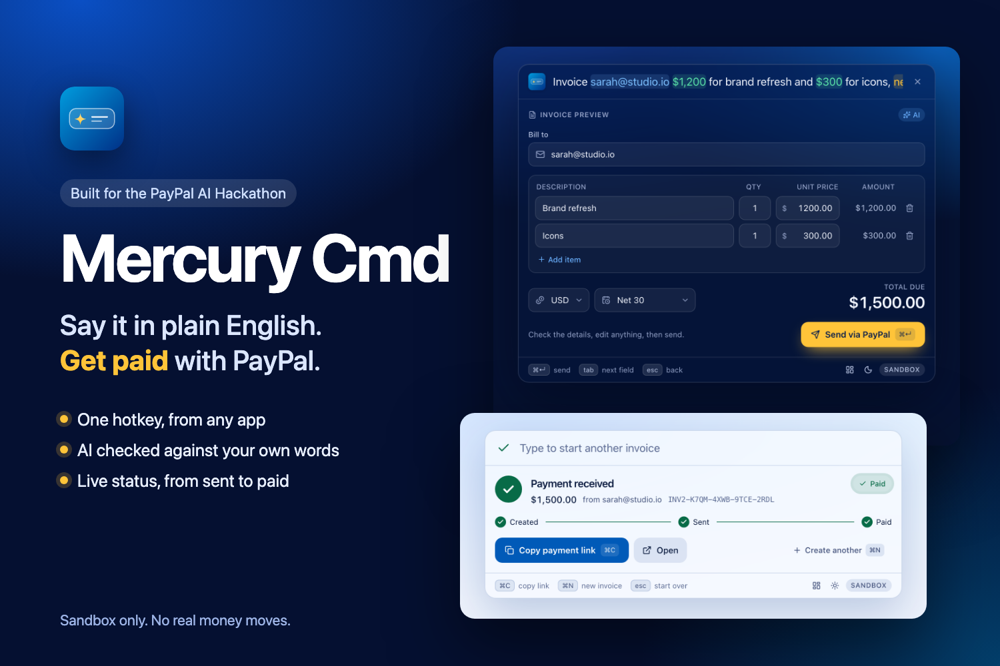

**A system-wide AI command palette that turns plain English into real PayPal invoices.**
Press a hotkey from any app, type *"Bill sarah@acme.co $1,200 for brand refresh and $300 for icons, net 15"*, review an editable preview, press `⌘↵`, and a PayPal invoice is created, sent, and tracked until it is paid.

 

> Built for the **PayPal AI Hackathon** (Oct 1 to Nov 12, 2026). Everything here was created during the submission period.
> **Sandbox only:** no real money moves, and the backend refuses to start against a non-sandbox PayPal host.

## Screenshots

Real UI, rendered by the app itself (`make shots`). Dark and light themes follow the system setting, with a toggle in the footer.

| | Dark | Light |
| :--- | :---: | :---: |
| **Describe it**: examples, recent invoices, live entity highlighting | 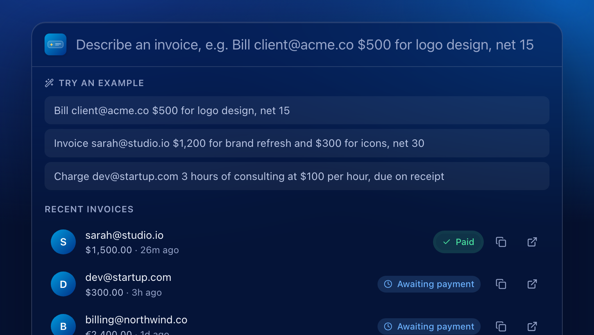 | 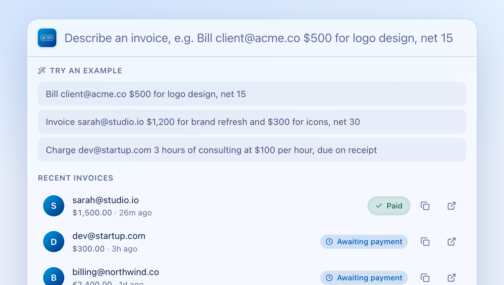 |
| **Review it**: editable preview, checked against your words | 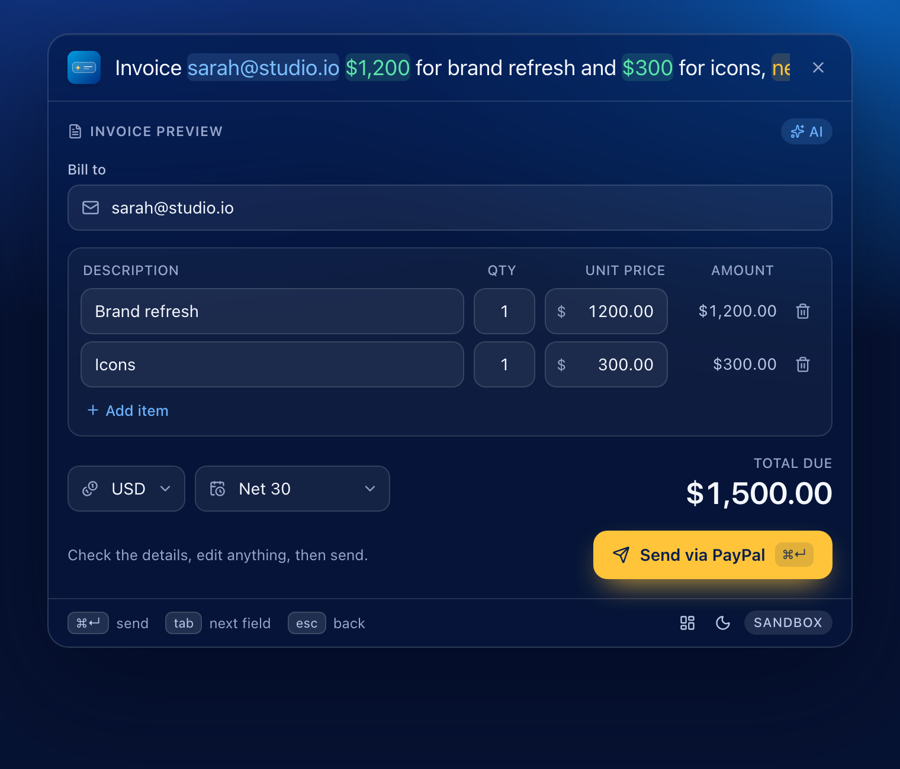 | 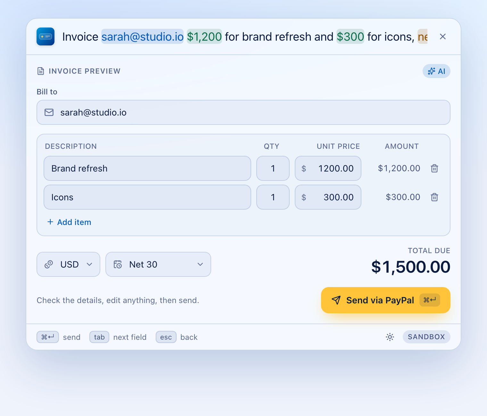 |
| **Track it**: Created, Sent, Paid, live | 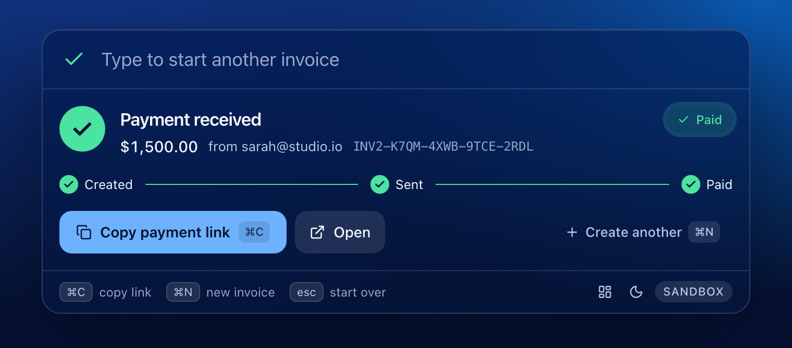 | 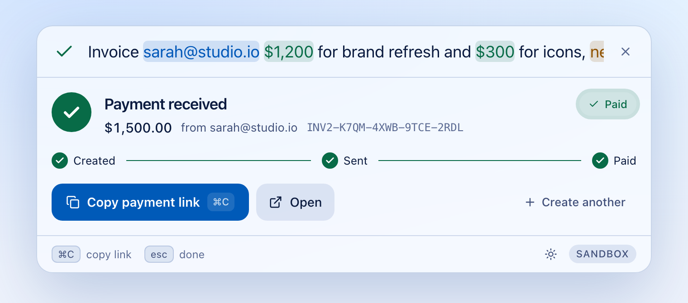 |
| **Look back**: Dashboard with history and invoice detail | 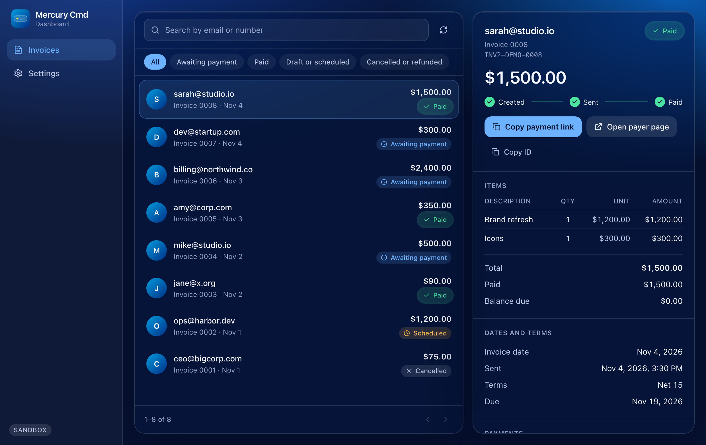 | 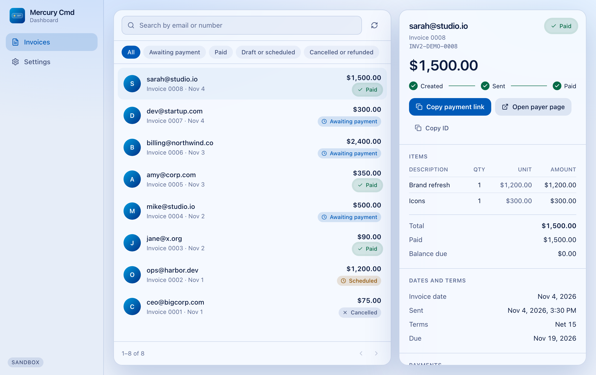 |
| **Configure**: live health, theme, shortcut | 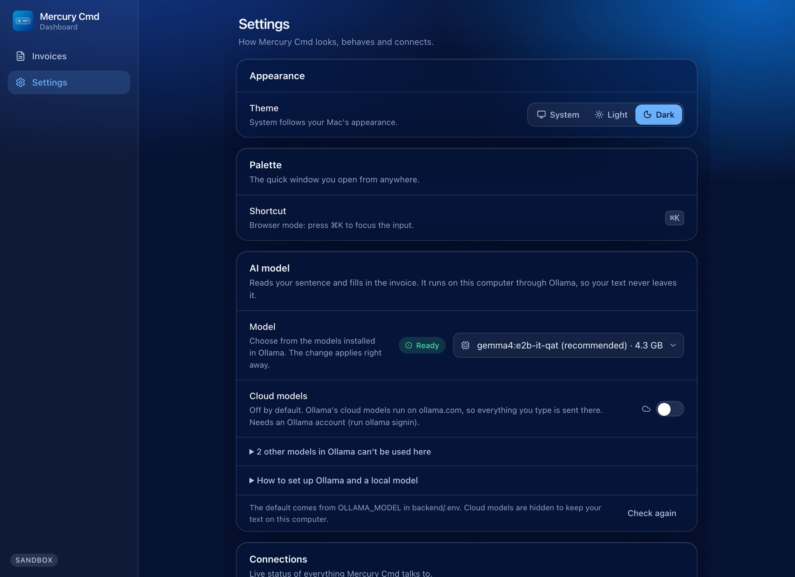 | 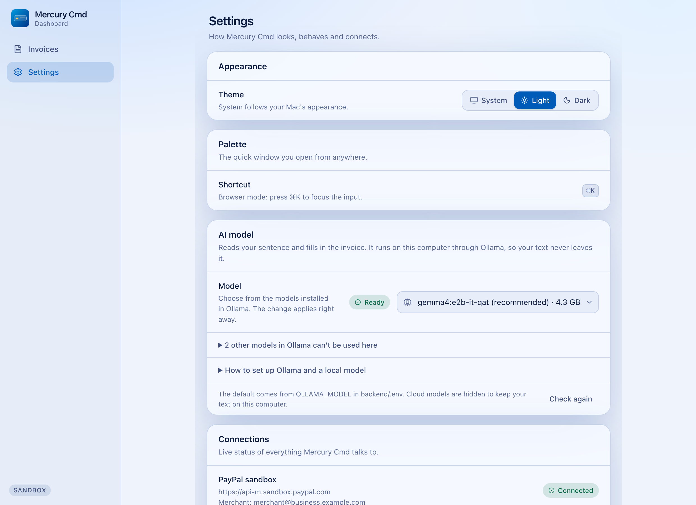 |

---

## What it does

- **Natural-language invoicing.** One sentence in, a structured invoice out: client email, one or many line items, quantities, currency (USD, EUR, GBP, CAD, AUD), and payment terms ("net 30", "due on receipt", "due in 2 weeks").
- **AI you can trust with money.** A local LLM proposes the invoice, then **server-side grounding** rejects anything the user did not actually type: an email that is not in the text, an amount that is not in the text, an invented quantity or term. Completeness is computed by the server, never taken from the model.
- **Always works.** If Ollama is missing, slow, or returns junk, a deterministic rule-based parser answers instead (clearly labelled "Basic mode").
- **Review before anything is sent.** An editable preview card with live totals and amber "Missing: email" badges.
- **Full PayPal loop.** Create draft → send → payer link → **live status** (Sent → Paid) right in the palette.
- **Safe by construction.** Duplicate submits create one invoice; a failed send keeps the draft and offers *Retry send*; invoicing your own merchant account is blocked before any API call.
- **You can see what the AI understood.** As you type, the email, amounts and payment terms light up in the input, and the preview fills in field by field.
- **A real product feel.** Empty state with one-click examples, a recent-invoices list with live status, a Created → Sent → Paid timeline, a PayPal-blue palette in dark and light themes, and a menu-bar icon with Open and Quit.
- **A full Dashboard.** A real window (title bar, minimize, zoom, resize) with your whole invoice history from PayPal, status filters and search, a detail view for every invoice (items, totals, dates, payments, transaction ID), and Settings with theme, shortcut, pinning, an AI model picker with setup steps, and live PayPal and backend health.
- **Made for repeat use.** The box clears after a send and typing starts the next invoice, `Esc` starts over without closing, `⌘N` starts a new one, a pin keeps the palette open, and it opens on the screen you are using.
- **Accessible.** Keyboard-first (global hotkey, `⌘↵` to send, `⌘N` for a new invoice, `⌘,` for the Dashboard, `Esc` to step back, `⌘C` to copy the link, arrow keys through examples), labelled controls, a `main` landmark, reduced-motion support, and WCAG AA contrast checked by tests in both themes.

## How PayPal is used (PayPal Invoicing API v2, sandbox)

| Step | Endpoint | Notes |
| :--- | :--- | :--- |
| Auth | `POST /v1/oauth2/token` | Cached until near expiry, one lock, one transparent refresh on a 401 |
| Create draft | `POST /v2/invoicing/invoices` | Money as exact decimals; payment term mapped to `NET_x` / `DUE_ON_RECEIPT` |
| Send | `POST /v2/invoicing/invoices/{id}/send` | Retried with backoff (PayPal can 404 right after create) |
| Link + status | `GET /v2/invoicing/invoices/{id}` | `recipient_view_url`; polled for `PAID` (every 4 s, then every 15 s for up to an hour, and instantly when you return to the window) |
| History | `POST /v2/invoicing/search-invoices` | Powers the Dashboard list: status and email filters, newest first |

Real-world quirks found against the live sandbox and handled in code (see `mercury_cmd_execution_spec.md` section 4): create returns a link object, not an `id`; PayPal can answer errors with a misleading top-level name (the truth is in `details[0]`); and sending a local `invoice_date` can make an invoice `SCHEDULED` instead of sent when your calendar day is ahead of the US.

## How AI is used

- **Model:** a local [Ollama](https://ollama.com) model (`gemma4:e2b-it-qat` by default) with **JSON-schema structured output** and temperature 0. No data leaves the machine, unless you opt in to Ollama's cloud models in Settings (off by default).
- **Grounding layer** (`backend/app/services/grounding.py`): every value must be backed by the user's text or it is dropped with a visible warning.
- **Evaluation:** `make eval` runs a 33-case corpus through the real model (33/33) and through the regex fallback (30/30 on the cases it supports). The corpus is developer-written, so it is a regression suite, not an unbiased benchmark.
- **Latency:** a few seconds per parse once the model is loaded (3 to 5 s on the development Mac). The first parse after the model has been idle can take 10 to 15 s; past the 8-second limit that one read falls back to Basic mode. The backend warms the model at startup.

---

## Quickstart

### Prerequisites
- macOS, Node.js 20+, Python 3.12+
- Rust ([rustup.rs](https://rustup.rs)) **only for the desktop app**; the browser mode needs no Rust
- Optional: [Ollama](https://ollama.com) for the AI parser

### 1. Setup (about 2 minutes)
```bash
make setup
```
This creates the Python virtualenv, installs dependencies, and writes `backend/.env` and `frontend/.env.local` with a generated shared token.

### 2. PayPal sandbox setup (about 5 minutes)
Testers of this submission: sandbox credentials are provided in the Devpost *testing instructions*; paste them into `backend/.env` and skip to step 3. To use your own:

1. Log in at [developer.paypal.com](https://developer.paypal.com) → **Testing Tools → Sandbox Accounts**.
2. Make sure there is a **Business** (merchant) and a **Personal** (buyer) sandbox account, **both with country United States**. (India-based sandbox accounts cannot send invoices: `INR_FOREIGN_CURRENCY_BLOCKED`.)
3. **Apps & Credentials → Sandbox → Create App** (type *Merchant*, pick the Business account). **Tick *Invoicing* under Features and click Save *before* you use the credentials for the first time.** PayPal reuses the access token it issued earlier, so enabling Invoicing afterwards can leave you with a token that returns `403 NOT_AUTHORIZED`; if that happens, create a fresh app.
4. Put these in `backend/.env`:
   ```
   PAYPAL_CLIENT_ID=...
   PAYPAL_CLIENT_SECRET=...
   PAYPAL_MERCHANT_EMAIL=<the Business account's sandbox email>
   PAYPAL_API_BASE=https://api-m.sandbox.paypal.com   # the REST API host, NOT https://sandbox.paypal.com
   ```
5. Note the **Personal** account's sandbox email: that is who you invoice. It must not be the Business email.

### 3. Optional: the AI parser (Ollama)
Mercury Cmd reads your sentence with a model that runs on your own computer through [Ollama](https://ollama.com). Setup takes a few minutes, once:

1. **Install Ollama.** Download the Mac app from [ollama.com/download](https://ollama.com/download) and open it (a llama icon appears in the menu bar), or run `brew install ollama` and then `ollama serve` in a Terminal window you leave open.
2. **Download the tested model** (about 4.3 GB, one time):
   ```bash
   ollama pull gemma4:e2b-it-qat
   ```
3. **Check it is there:**
   ```bash
   ollama list
   ```
4. Start Mercury Cmd. **Dashboard → Settings → AI model** should say **Ready**.

The same steps, with copy buttons, are in **Settings → AI model → How to set up Ollama and a local model**. If you skip this section, Mercury still works in rule-based "Basic mode" (single item per invoice).

**Choosing a different model.** Run `ollama pull <name>`, press **Check again** in Settings and pick it from the list. It applies right away and is remembered in `backend/.mercury-prefs.json` (git-ignored). The default for a fresh checkout is `OLLAMA_MODEL` in `backend/.env`.

- Settings lists every model your Ollama has. Embedding models are shown greyed out because they cannot read a sentence.
- **Cloud models are off by default.** Models whose names end in `:cloud` run on ollama.com, so the sentence you type would leave your computer. They are listed greyed out until you turn on **Settings → AI model → Cloud models**. Then they appear in the model list marked "cloud", the AI model section says so while one is selected, and turning the switch off again returns you to a local model at once. Cloud models need an Ollama account (`ollama signin`). The recorded demo and the 33-case evaluation use the local model only.
- Only `gemma4:e2b-it-qat` has been checked against the 33-case corpus. With another model, read the preview before sending, or measure it with `OLLAMA_MODEL=<name> make eval`.
- Ollama on a different machine or port: set `OLLAMA_BASE_URL` in `backend/.env` and restart the backend.
- The first read after the model has been idle can take 10 to 15 seconds while it loads, and if it passes 8 seconds that read uses Basic mode. Later ones take a few seconds.

### 4. Run

**Browser mode (no Rust):**
```bash
make dev-web        # then open http://localhost:1420
```

**Desktop app (global hotkey):**
```bash
make dev            # first build compiles Rust and takes a few minutes
```
Press **⌘⇧Space** from any app to open the palette (change it with `MERCURY_HOTKEY`, for example `Alt+Space`).

### 5. Try it
1. Type `Bill <buyer-sandbox-email> $1,200 for brand refresh and $300 for icons, net 15` and wait a moment.
2. Check the preview, edit anything, press **⌘↵**.
3. Click **Open**, log in at the payer page as the sandbox **Personal** account, and pay.
4. Watch the palette's status pill change to **Paid** within a few seconds.
5. Open the **Dashboard** (footer icon, `⌘,`, or the menu-bar icon) to see all your invoices, open one for its full detail, and check the live connection status in Settings.

Prefer the command line? `make smoke TO=<buyer-email>` runs the raw PayPal round trip without the UI.

---

## Architecture

```
┌──────────────────────────────────────────────────────┐
│ Tauri v2 desktop shell (Rust)   │  or a plain browser │
│  global hotkey · glass window   │                     │
│  React 19 + TypeScript + Tailwind v4 + Motion        │
└───────────────┬──────────────────────────────────────┘
                │ HTTP 127.0.0.1:47891  (X-Mercury-Token)
┌───────────────▼──────────────────────────────────────┐
│ FastAPI backend (Python, httpx async)                │
│  /api/parse   → Ollama (JSON schema) → grounding     │
│                 └→ regex parser when the model fails │
│  /api/invoice → PayPal create → send → link/status   │
│  /api/invoices, /api/invoice/{id}/detail → history   │
│  /api/info → live health for Settings                │
└───────────────┬───────────────────────┬──────────────┘
                │                       │
        Ollama (local)          PayPal Sandbox REST API
```

| Path | What lives there |
| :--- | :--- |
| `backend/app/services/paypal_service.py` | Token cache, create/send/status, idempotency, retries, error mapping |
| `backend/app/services/grounding.py` | The checks that make AI output safe to act on |
| `backend/app/services/ai_service.py` | Ollama client, JSON schema, LLM → regex orchestration |
| `backend/app/services/regex_parser.py` | Deterministic fallback parser |
| `frontend/src/hooks/usePalette.ts` | The palette state machine |
| `frontend/src/components/` | Palette, entity-highlighting input, preview card, success card with live status, recents |
| `frontend/src/components/dashboard/` | The Dashboard window: invoices, invoice detail, settings |
| `frontend/src/index.css` | Theme tokens (dark and light) as CSS variables |
| `frontend/src-tauri/src/lib.rs` | Hotkey, window show/hide, blur handling |
| `scripts/` | `setup.sh`, `dev.sh`, `paypal_smoke.py`, `eval_parser.py` |

## Tests

```bash
make test       # 180 backend tests (mocked PayPal and Ollama) + 121 frontend tests (logic, Dashboard, axe accessibility, WCAG contrast) + type check
make eval       # parse corpus against the real local model
make smoke TO=<sandbox buyer email>   # real sandbox round trip
make shots      # regenerate the README screenshots and cover (needs Google Chrome)
```

## Security notes
- Sandbox only: the backend exits at startup if `PAYPAL_API_BASE` is not a sandbox REST host.
- The backend binds to `127.0.0.1`, requires a shared token header on every route except `/api/health`, and only allows the app's own origins through CORS.
- Secrets live in git-ignored `.env` files; nothing sensitive is logged.
- The AI can only suggest: every value is verified against the user's text, and nothing is sent without the user pressing send on a visible preview.

## Known limitations
- macOS only for the desktop app (global shortcuts are unreliable on some Linux setups; Windows is untested).
- Basic mode handles a single item per invoice.
- The Dashboard shows and opens invoices; cancelling or reminding from the app is not included yet.
- Currencies are limited to USD, EUR, GBP, CAD and AUD (PayPal rejects decimals for zero-decimal currencies such as JPY).
- Live status runs while the success card is open: every 4 s for 2 minutes, then every 15 s for up to an hour, plus an immediate check whenever the window regains focus. Reopened palettes refresh recent invoices from PayPal.

## Documentation

| Document | What it covers |
| :--- | :--- |
| [User guide, guidelines and FAQ](docs/Mercury-Cmd-Guide.pptx) | PowerPoint: purpose, quick start, shortcuts, writing requests, safety, statuses, do and don't, four FAQ slides and a troubleshooting table |
| [Testing and verification](docs/TESTING.md) | What is tested automatically and live, and scenarios you can try in the running app |
| [Design and API spec](mercury_cmd_execution_spec.md) | Architecture, PayPal pipeline, parsing and grounding rules |

## License
[MIT](LICENSE)
